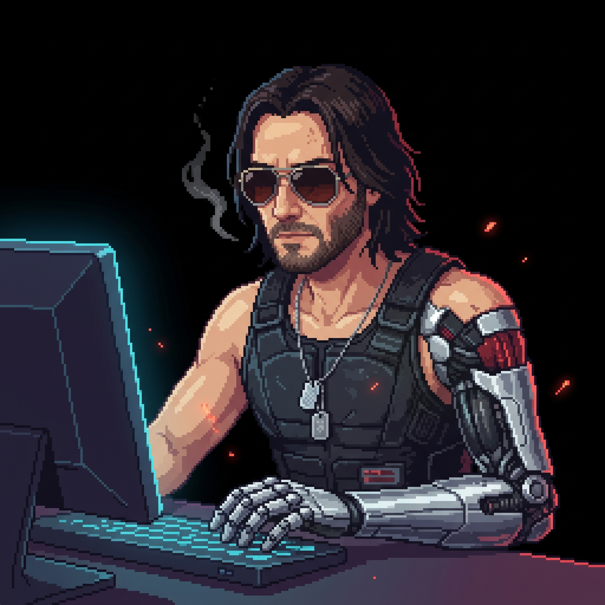

<div align="center">
  
</div>

<div align="center">
  
</div>

### 👨‍💻 Hakkımda


- 🎓 **Eğitim:** Ankara Yıldırım Beyazıt Üniversitesi — Yazılım Mühendisliği (1. Sınıf)
- 🔐 **İlgi Alanları:** Siber Güvenlik (CTF, Tersine Mühendislik, Ağ Güvenliği), Bilgisayar Ağları ve Yerel LLM İş Akışları
- 💻 **Odak:** C ve Python ile temel algoritma ve sistem programlama pratikleri geliştiriyor, sanallaştırılmış ağ laboratuvarlarında paket analizi yapıyorum.
- 🐧 **Ortam:** Dual-boot Ubuntu Linux & Windows

<br clear="right"/>

---

### 🛠️ Teknolojiler ve Araçlar

<div align="left">
  
  
  
  
  
  
  
</div>

<br/>

<div align="center">
  
  
</div>

---

### 🛡️ TryHackMe & İstatistikler

<div align="center">
  <a href="https://tryhackme.com/p/raptorjet06" target="_blank">
    
  </a>
</div>

---

```text
______
L,.   ',
 \      ',_                
  \   C*   ',
   \        ',
    \    TR   ',
     \___90-0002 ',_                         _..----.._
     [______       "'==.I\_____________..--"<__\\_n@___4\,_
   ,..-=T         __   ____________          \/  "'" o<==  ""-+.._
   I____|_____    }_>=========I>=**^^~~==-------------==-   " |   ""-.,___
   [_____,.--'"             _______         ""--=<""-----=====+==--''""
   ""'-=+..,,__,-----,_____|       |         -=* |
               |__   /     |---,--'"---+------+-'"
                  """     d"b="        '-----+t
                          q_p                '@
```

---

### 🐍 Contribution Snake

<div align="center">
  <picture>
    <source media="(prefers-color-scheme: dark)" srcset="https://raw.githubusercontent.com/BRKCoruk/BRKCoruk/output/github-contribution-grid-snake-dark.svg" />
    <source media="(prefers-color-scheme: light)" srcset="https://raw.githubusercontent.com/BRKCoruk/BRKCoruk/output/github-contribution-grid-snake.svg" />
    
  </picture>
</div>
