  

---

### 👨‍💻 Hakkımda

- 🎓 **Eğitim:** Ankara Yıldırım Beyazıt Üniversitesi — Yazılım Mühendisliği (1. Sınıf)
- 🔐 **İlgi Alanları:** Siber Güvenlik (CTF, Tersine Mühendislik, Ağ Güvenliği), Bilgisayar Ağları ve Yerel LLM İş Akışları
- 💻 **Odak:** C ve Python ile temel algoritma ve sistem programlama pratikleri geliştiriyor, sanallaştırılmış ağ laboratuvarlarında paket analizi yapıyorum.
- 🐧 **Ortam:** Dual-boot Ubuntu Linux & Windows

 

---

### 🛠️ Teknolojiler ve Araçlar

  
  
  
  
  
  
  

 

  
  

---

### 🛡️ TryHackMe & İstatistikler

  

---

### 🐍 Contribution Snake

  <picture>
    <source media="(prefers-color-scheme: dark)" srcset="https://raw.githubusercontent.com/BRKCoruk/BRKCoruk/output/github-contribution-grid-snake-dark.svg" />
    <source media="(prefers-color-scheme: light)" srcset="https://raw.githubusercontent.com/BRKCoruk/BRKCoruk/output/github-contribution-grid-snake.svg" />
    
  </picture>

